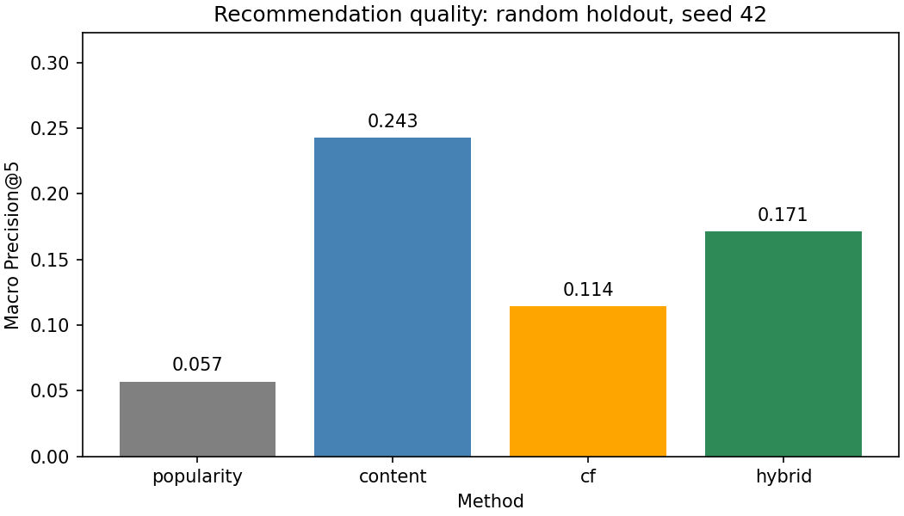

# University Elective Course Recommender

| Field | Details |
|---|---|
| Student | Nguyen Tan Dat |
| Student ID | 29211148673 |
| Section | CS467A (No. 03) |
| Course | CS467 Advanced Artificial Intelligence, 2026-2027 |
| Instructor | Puri Vikram |
| Project | MP-A03 - University Elective Course Recommender |

## Problem

Students need elective courses that match their career interests. This small Python
application combines syllabus matching with course ratings from simulated senior
students. It returns five unseen courses with scores and matching keywords.

## Setup and run

Use Python 3.11 or later. This version was checked on Python 3.12.14.

```bash
python -m venv .venv
```

On Windows:

```powershell
.\.venv\Scripts\python.exe -m pip install -r requirements.txt
.\.venv\Scripts\python.exe src/main.py --demo
.\.venv\Scripts\python.exe src/evaluate.py
```

On macOS/Linux, replace `.\.venv\Scripts\python.exe` with `.venv/bin/python`.
The demo also runs without arguments and saves `results/sample_outputs.txt`.
After activating the environment, try:

```bash
python src/main.py --query "I want to learn backend APIs, cloud deployment, and databases"
python src/main.py --user U001 --method popularity
python src/main.py --user U001 --method content
python src/main.py --user U001 --method cf
python src/main.py --user U001 --method hybrid
python src/main.py --item C001
```

Queries and course descriptions are in English. Unknown student IDs and queries
with no catalog vocabulary produce a short error message.

## Dataset

Both CSV files contain original, fictional data, not real student records or
official university syllabi. No public dataset was adapted.

| File | Columns | Size |
|---|---|---|
| `data/items.csv` | item_id, course_code, title, department, syllabus_text, skills_tags | 36 courses, 6 departments |
| `data/ratings.csv` | user_id, item_id, rating, feedback_comment | 14 students, 252 ratings from 1 to 5 |

Each student rated 18 courses, including six in a preferred subject group.
Ratings include noise and feedback uses varied templates. All course descriptions
are distinct. The matrix has 504 possible entries and 252 observed ratings:
**50% missing entries**. Eighteen ratings per student exceeds the minimum of
4-6 and keeps sparsity within the required 40%-65%.

U001 rated AI/data courses C007-C012 5/5. C036, *Serverless Cloud APIs*, has no ratings.
The original synthetic data was generated with seed 2026; its generation script
remains available in the earlier Git history.

## Methods

- **NLP:** combine title, syllabus and skill tags; lowercase, remove punctuation,
  split into words and remove English stop words. TF-IDF uses unigrams and bigrams.
  New queries use the fitted catalog vocabulary. Cosine similarity measures text
  matching; the four largest shared TF-IDF contributions explain each recommendation.
- **Popularity:** rank by average rating, require at least two ratings and exclude
  courses the student already rated.
- **Content:** compare a query, source course or student profile with every course.
  Profile weights are `max(rating - 3, 0)`; if all are zero, use ratings.
  Item-to-item recommendations exclude the source course.
- **User-based CF:** Pearson correlation on at least three shared ratings selects
  up to five positive neighbors. Predict the student's mean plus the weighted
  neighbors' deviations from their means. With no usable neighbors, use the course
  average. A course with no ratings uses the global average. Predictions stay in 1-5.
- **Hybrid:** combine cosine similarity, CF predictions and average ratings.
  Normalize a rating as `(rating - 1) / 4`, then use:

```text
Existing student: 0.70 * cosine + 0.20 * normalized_CF + 0.10 * normalized_average
New query:       0.75 * cosine + 0.25 * normalized_average
```

All methods exclude rated courses for an existing student. Hybrid and Content
allow unrated courses. Ranking scores are not probabilities, and scores from
different methods have different scales. Hybrid weights are fixed design choices.

## Three required test cases

Run `python src/main.py --demo` for complete scores and keyword explanations.
The first two cases use the 35-course catalog before C036 is launched.

**1. Career goal query**

```text
I want to learn backend APIs, cloud deployment, and databases

1. C004 Distributed Microservices        0.4885
2. C002 Cloud Application Deployment     0.4345
3. C001 Backend API Development          0.3873
4. C006 NoSQL and Data Storage           0.2911
5. C003 Database Systems and SQL         0.2615
```

For C004, matching keywords include "cloud deployment", "apis" and "cloud".

**2. Existing student who rated AI/data courses 5/5**

U001 already rated C007-C012 5/5. Content recommends the following unseen electives:

```text
1. C029 Financial Data Analytics         0.0801
2. C032 Statistical Computing            0.0723
3. C025 Business Intelligence            0.0677
4. C001 Backend API Development          0.0530
5. C030 Operations Analytics             0.0446
```

For C029, matching keywords include "data", "python" and "analytics".

**3. New course with no ratings**

The demo adds C036 to the catalog, increasing it from 35 to 36 courses while
leaving ratings unchanged. Query:

```text
serverless backend APIs, cloud functions, cloud deployment and managed databases

1. C036 Serverless Cloud APIs (New Elective)  0.6846
2. C004 Distributed Microservices             0.3836
3. C002 Cloud Application Deployment          0.3517
4. C001 Backend API Development               0.3137
5. C006 NoSQL and Data Storage                0.2508
```

C036 ranks first with zero ratings. Its keywords include "serverless" and
"cloud functions". A demo assertion checks that it appears in Top-5.
Full output: [sample_outputs.txt](results/sample_outputs.txt).

## Evaluation

A random per-student holdout uses seed 42 and hides `ceil(18 * 0.20) = 4`
ratings per student: **196 train / 56 test**, or 22.22% test after rounding.
Rating-derived state uses training data only. TF-IDF uses catalog metadata,
which is available when courses are recommended.

Each method ranks the full catalog excluding training history. A hit is a hidden
course rated at least 4. Unobserved courses count as non-hits.
`Precision@5 = hits / 5`, averaged over all 14 students, including students
with no relevant hidden courses.

| Method | Precision@5 |
|---|---:|
| Popularity | 0.0571 |
| Content | 0.2429 |
| User-based CF | 0.1143 |
| Hybrid | 0.1714 |

CF rating prediction on all 56 hidden ratings: **MAE = 0.9392**, **RMSE = 1.1596**.
Hybrid scores are ranking signals, so rating errors are calculated only for CF.
Running `src/evaluate.py` prints the evaluation results and recreates both charts.




## Project structure

```text
cs467-miniproject-29211148673/
|-- README.md
|-- requirements.txt
|-- .gitignore
|-- data/
|   |-- items.csv
|   +-- ratings.csv
|-- src/
|   |-- nlp_pipeline.py
|   |-- recommender.py
|   |-- evaluate.py
|   +-- main.py
+-- results/
    |-- sample_outputs.txt
    |-- data_distribution.png
    +-- evaluation_comparison.png
```

A notebook is optional in the assignment; this project uses the Python entry point.

## Reflection and references

Content performed best on this split because the synthetic preferences follow
subject groups with related vocabulary. The system explains text matches and
handles a new course without ratings. CF and Hybrid demonstrate rating-based
personalization, but Hybrid did not outperform Content.

Limitations include small synthetic data, one test split, repeated feedback
templates, English keyword matching and fixed hybrid weights. The application
does not check prerequisites, timetables or course availability. More real data,
validation splits and better text representations would improve the study.

API reference: [scikit-learn TfidfVectorizer](https://scikit-learn.org/stable/modules/generated/sklearn.feature_extraction.text.TfidfVectorizer.html).

OpenAI Codex assisted with implementation and documentation. The student should
understand and be able to explain the submitted work.
