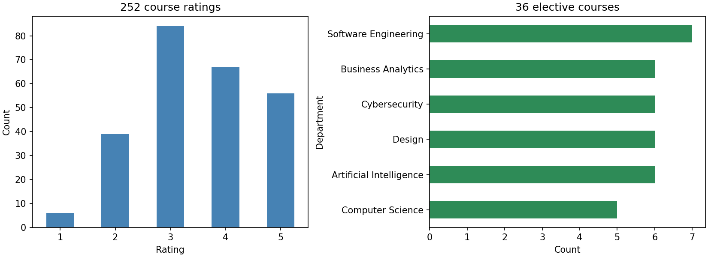

# University Elective Course Recommender — MP-A03

Ứng dụng Python gợi ý môn tự chọn theo định hướng nghề nghiệp bằng NLP,
đánh giá môn học và User-Based Collaborative Filtering.

| Thông tin | Nội dung |
|---|---|
| Sinh viên | Nguyễn Tấn Đạt |
| Mã sinh viên | 29211148673 |
| Lớp | CS467A (No. 03) |
| Môn học | CS467 Advanced Artificial Intelligence, 2026–2027 |
| Trường | Duy Tan University |
| Giảng viên | Puri Vikram |
| Project | MP-A03 — University Elective Course Recommender |
| Repository bắt buộc | `cs467-miniproject-29211148673` |

## 1. Bài toán và phạm vi

Sinh viên cần chọn môn tự chọn phù hợp nghề nghiệp. Ứng dụng nhận câu mục tiêu
tiếng Anh hoặc mã sinh viên, trả về Top-5 môn, điểm số và từ khóa giải thích.
Hệ thống hỗ trợ tìm môn tương tự, gợi ý theo lịch sử, CF từ sinh viên khóa trên
và xếp hạng lai. Môn mới chưa có đánh giá vẫn được gợi ý từ đề cương.

Đây là công cụ học thuật trên **dữ liệu mô phỏng**, chưa phải hệ thống tư vấn
chính thức của trường. Chưa kiểm tra điều kiện tiên quyết, lịch học, tín chỉ
hoặc môn có thực sự được mở. Điểm xếp hạng không phải xác suất thành công.

**Tài liệu tiếng Việt:** [Bản dịch đầy đủ đề bài](docs/BAN_DICH_DE_BAI_VI.txt)
và [Hướng dẫn từng bước, công thức, lệnh chạy, hỏi đáp](docs/HUONG_DAN_THUC_HANH_VI.txt).
Phần chú thích triển khai được tách khỏi bản dịch nội dung đề gốc.

## 2. Cài đặt và chạy

Đã kiểm thử với CPython 3.13.7 trên Windows. Khuyến nghị Python 3.11–3.13;
các phiên bản khác chưa được kiểm thử. Không cần khóa API, dịch vụ cloud,
mô hình tải ngoài hoặc NLTK corpus khi chạy.

Mở terminal tại thư mục project:

```powershell
python -m venv .venv
.\.venv\Scripts\python.exe -m pip install -r requirements.txt
.\.venv\Scripts\python.exe src/main.py --demo --save-samples
.\.venv\Scripts\python.exe src/evaluate.py
.\.venv\Scripts\python.exe -m unittest discover -s tests -v
```

Trên macOS/Linux, thay `.\.venv\Scripts\python.exe` bằng `.venv/bin/python`.
Không cần kích hoạt môi trường nên không phụ thuộc chính sách chạy PowerShell.
`requirements-lock.txt` lưu toàn bộ phiên bản của môi trường dùng tạo kết quả;
muốn tái lập môi trường Windows/Python 3.13 có thể cài từ tệp này.

Các ví dụ dưới đây dùng `python` khi môi trường đã được kích hoạt; hoặc thay
`python` bằng đường dẫn Python trong `.venv` như các lệnh trên:

```bash
# Không có tham số: chạy cả ba test case
python src/main.py

# Mục tiêu nghề nghiệp của người mới
python src/main.py --query "I want to learn backend APIs, cloud deployment, and databases"

# So sánh các phương pháp cho cùng một sinh viên
python src/main.py --user U001 --method popularity
python src/main.py --user U001 --method content
python src/main.py --user U001 --method cf
python src/main.py --user U001 --method hybrid

# Môn tương tự (content); loại bỏ chính môn gốc
python src/main.py --item C001

# Kết hợp mục tiêu mới với lịch sử sinh viên
python src/main.py --user U001 --query "backend APIs and cloud deployment" --method hybrid

# Hoạt động cả bằng package entry point
python -m src.main --query "network security and cryptography" --top-k 5
python -m src.evaluate --seed 42
python src/main.py --help
```

Sinh viên mới dùng `--query`; mã sinh viên chưa tồn tại sẽ được báo rõ.
Truy vấn rỗng hoặc hoàn toàn ngoài từ vựng tiếng Anh bị từ chối với hướng dẫn
nhập lại. Nội dung tiếng Việt chưa được hỗ trợ bởi mô hình TF-IDF này.

## 3. Dữ liệu và kiểm tra chất lượng

Toàn bộ dữ liệu được tạo mới cho project, không sao chép dữ liệu sinh viên,
không khảo sát người thật và không lấy đề cương chính thức của trường.
Tên/mã môn chỉ mang tính minh họa. Các ID U001–U014 là 14 sinh viên khóa trên
giả lập. Nguồn dữ liệu có thể tái lập: `scripts/generate_data.py`, seed `2026`.

| Tệp | Schema | Quy mô |
|---|---|---|
| `data/items.csv` | item_id, course_code, title, department, syllabus_text, skills_tags | 36 môn, 6 khoa/bộ môn |
| `data/ratings.csv` | user_id, item_id, rating, feedback_comment | 14 sinh viên, 252 điểm nguyên 1–5 |

Mỗi người có 18 đánh giá: 6 môn trong nhóm ưu tiên và 12 môn được chọn ngoài
nhóm. Nhóm ưu tiên được dùng khi tạo dữ liệu; thuật toán không được đọc nhóm
đó. Điểm được lấy mẫu với nhiễu theo mức quan tâm; nhận xét được chọn từ các
mẫu khác nhau theo điểm. Không sử dụng feedback để học TF-IDF hoặc dự đoán.
Do số mẫu nhận xét hữu hạn, nhận xét có thể lặp; đề cương 36 môn có nội dung riêng.

- Ma trận có `14 × 36 = 504` ô; 252 ô có điểm, **50% ô thiếu**.
- Mỗi người đánh giá ít nhất 4–6 môn và thực tế có 18 đánh giá để đạt độ thưa
  40%–65% trong đề. Chỉ 4–6 điểm/36 môn sẽ tạo 83,3%–88,9% ô thiếu.
- U001 chấm toàn bộ 6 môn AI/data C007–C012 5/5, phục vụ test case 2.
- C036/SWE390 **Serverless Cloud APIs** là môn mới có **0 lượt đánh giá**.
- `validate_data` kiểm tra schema, giá trị rỗng, mã trùng, đánh giá trùng cặp
  người–môn, điểm ngoài 1–5/không nguyên và mã môn không tồn tại.

Tái tạo dữ liệu bằng `python scripts/generate_data.py`.



## 4. Pipeline NLP

`src/nlp_pipeline.py` ghép **title + syllabus_text + skills_tags** của mỗi môn.
Các bước: chữ thường → dấu câu thành khoảng trắng → gộp khoảng trắng → tách từ
→ bỏ stop words tiếng Anh và token một ký tự → TF-IDF unigram + bigram.

Sử dụng `TfidfVectorizer(ngram_range=(1, 2), sublinear_tf=True, norm="l2")`.
Với từ xuất hiện `f > 0`: `tf = 1 + ln(f)`;
`idf = ln((1 + N)/(1 + df)) + 1`; nhân tf với idf rồi chuẩn hóa L2.
Độ tương đồng: `cosine(q, d) = (q · d) / (||q|| ||d||)`.

`transform()` dùng lại từ vựng đã fit trên catalog, không fit trên câu truy vấn.
Từ khóa giải thích là các unigram/bigram dùng chung, xếp theo tích trọng số
TF-IDF của chúng. `top_terms()` trích từ quan trọng của riêng một đề cương.
Việc bỏ từ dừng có thể tạo bigram giữa hai từ vốn ngăn nhau bởi từ dừng.

Khi thêm môn vào catalog, ứng dụng khởi tạo lại mô hình catalog. Truy vấn sau
đó tiếp tục dùng vectorizer của catalog đã cập nhật. Việc cập nhật catalog
khác với việc fit lại vectorizer cho từng truy vấn.

## 5. Các phương pháp gợi ý

### Popularity Baseline

Xếp theo trung bình có làm trơn:

```text
pop(i) = (n_i × mean_i + 3 × global_mean) / (n_i + 3)
```

Ngưỡng tối thiểu 2 đánh giá, lọc môn sinh viên đã đánh giá. `3` là độ mạnh prior,
giảm ảnh hưởng của các môn quá ít điểm. Không biến ô thiếu thành điểm 0.

### NLP Content-Based

Truy vấn và item-to-item dùng cosine trực tiếp. Hồ sơ người dùng là tổng có
trọng số của vector môn đã đánh giá, sau đó chuẩn hóa L2. Trọng số là
`max(rating − 3, 0)`; nếu mọi trọng số bằng 0, dùng chính rating làm dự phòng.
Gợi ý các môn chưa đánh giá gần hồ sơ nhất. Item-to-item loại môn gốc.

### User-Based Collaborative Filtering (phần mở rộng)

Tính Pearson trên các môn hai sinh viên cùng đánh giá, yêu cầu ít nhất 3 môn.
Thu nhỏ tương đồng theo `n_common/(n_common + 5)`, chỉ giữ giá trị dương,
lấy tối đa 5 láng giềng. Với môn i:

```text
prediction(u,i) = mean(u)
  + sum_v(sim(u,v) × (rating(v,i) − mean(v))) / sum_v(abs(sim(u,v)))
```

Chỉ cộng láng giềng có điểm môn i. Khi không có bằng chứng láng giềng, dùng
`pop(i)` làm dự phòng. Dự đoán được giới hạn 1–5. Với môn không có điểm nào,
prior là trung bình toàn cục. Các trung bình và tương đồng chỉ dùng tập ratings
truyền vào mô hình; lúc đánh giá đó là tập train.

### Hybrid Advisor

Chuẩn hóa điểm rating 1–5 bằng `norm(r) = (r − 1)/4`:

```text
Có lịch sử: score = 0.55 × cosine + 0.25 × norm(CF) + 0.20 × norm(pop)
Chỉ query:  score = 0.75 × cosine + 0.25 × norm(pop)
```

Khi có cả user và query, query thay hồ sơ trong phần cosine; CF vẫn dùng
lịch sử. Các trọng số là lựa chọn thiết kế cố định, chưa được tối ưu validation.
Môn mới không bị loại khỏi Content/Hybrid bởi ngưỡng lượt đánh giá của baseline.
Mọi phương pháp lọc lịch sử user, xếp giảm dần và dùng item_id để phá hòa ổn định.
Score giữa các phương pháp có thang đo khác nhau và không thể coi là xác suất.

## 6. Đánh giá ngoại tuyến

Seed `42`, ẩn ngẫu nhiên `ceil(20% × 18) = 4` đánh giá cho mỗi sinh viên:
**196 điểm train / 56 điểm test**; tỷ lệ test thực tế **22,22%** do làm tròn.
Chọn test không phụ thuộc điểm cao/thấp. Tất cả 14 người đều tham gia đánh giá;
12 người có ít nhất một điểm test >=4.

Mỗi phương pháp xếp **toàn bộ catalog trừ lịch sử train**. Tập phù hợp của user
là các môn test có rating >=4. Môn chưa quan sát bị tính là không trúng.

```text
Precision@5(u) = |Top5(u) giao relevant_test(u)| / 5
Macro Precision@5 = trung bình trên cả 14 user
Recall@5(u) = hits / số môn relevant_test(u)
```

Recall lấy trung bình trên 12 user có relevant test; hai user còn lại có
Precision bằng 0 nhưng Recall không xác định (NaN). Đây là hai tập mẫu số
khác nhau, được ghi rõ để tránh hiểu nhầm kết quả.

**Chống rò rỉ:** lịch sử, global/item/user means, láng giềng và CF chỉ tính từ
train. TF-IDF được phép nhìn metadata toàn catalog vì đề cương có sẵn khi
gợi ý; không đọc nhãn test/feedback. Mã kiểm thử thay nhãn ẩn và xác minh
train cùng gợi ý vẫn không thay đổi.

| Phương pháp | Macro Precision@5 | Recall@5 (12 user) | Tổng hits / 70 vị trí |
|---|---:|---:|---:|
| popularity | 0.0571 | 0.1389 | 4 |
| content | 0.2429 | 0.6458 | 17 |
| cf | 0.1143 | 0.3125 | 8 |
| hybrid | 0.1714 | 0.5069 | 12 |

CF dự đoán điểm số trên toàn bộ 56 điểm test: **MAE = 0.9168**, **RMSE = 1.1288**.
Không tính RMSE trực tiếp trên Hybrid vì Hybrid trả điểm xếp hạng thay vì
rating 1–5. Đây là kết quả đo được từ mã chạy, không phải số minh họa.


Trong lần chia này Content cao nhất, Hybrid đứng thứ hai. Dữ liệu được tạo
theo nhóm sở thích có thuật ngữ gần nhau nên thuận lợi cho TF-IDF; CF phải
suy luận từ ít láng giềng và điểm nhiễu. Trung bình điểm và cosine có phân bố
khác nhau dù đều được đưa về khoảng 0–1; Hybrid có thể bị tín hiệu rating
lấn át khi cosine nhỏ. Không suy ra Hybrid luôn tốt hơn Content.

Kết quả chỉ dùng một split của dữ liệu mô phỏng nhỏ, chưa có khoảng tin cậy,
chưa tối ưu trọng số bằng validation và chưa kiểm nghiệm trên người dùng thật.
Nhiều môn chưa được đánh giá có thể phù hợp nhưng bị tính là không trúng.
Muốn thử seed khác mà giữ nguyên kết quả chuẩn:

```bash
python src/evaluate.py --seed 7 --output-dir results/seed7
```

Tệp kiểm toán có trong `results/`: `metrics.csv`, `per_user_metrics.csv`,
`train_ratings.csv`, `test_ratings.csv`, `rating_predictions.csv`,
`evaluation_metadata.json`, `evaluation_summary.txt`. Demo dùng toàn bộ ratings;
đánh giá dùng train nên điểm và thứ hạng của hai chế độ có thể khác nhau.

## 7. Ba tình huống bắt buộc — đầu ra thực tế

Tạo lại bằng `python src/main.py --demo --save-samples`.
Test 1 giữ nguyên câu tiếng Anh trong đề. Test 2 hiển thị lịch sử AI/data 5/5
và cả Content/Hybrid để quan sát khác biệt. U001 đã đánh giá mọi môn của nhóm
AI, nên gợi ý tiếp theo là những môn còn lại; Content ưu tiên môn dữ liệu
liên quan, trong khi Hybrid có thể chọn môn ngoài lĩnh vực do tín hiệu rating.
Test 3 thực sự dựng catalog 35 môn rồi thêm C036, giữ nguyên 252 ratings;
assertion xác minh C036 có trong Top-5 khi chưa có điểm nào.

```text
MP-A03: THREE REQUIRED TEST CASES
Dataset is fictional; scores are ranking signals, not probabilities.
English syllabi and English goal statements are supported.

TEST 1 - Career goal query (hybrid)
Query: I want to learn backend APIs, cloud deployment, and databases
1. C036 SWE390 | Serverless Cloud APIs (New Elective)
   score=0.5490 | cosine=0.5230 | ratings=0
   Shared terms: cloud, apis cloud, apis, cloud deployment; new course, no ratings (global-mean prior)
2. C004 SWE304 | Distributed Microservices
   score=0.4395 | cosine=0.3601 | ratings=9
   Shared terms: cloud deployment, apis, cloud, deployment; 9 ratings
3. C002 SWE302 | Cloud Application Deployment
   score=0.4008 | cosine=0.3350 | ratings=6
   Shared terms: cloud, deployment, cloud deployment, backend; 6 ratings
4. C001 SWE301 | Backend API Development
   score=0.3519 | cosine=0.2232 | ratings=7
   Shared terms: apis, backend apis, backend, databases; 7 ratings
5. C006 SWE306 | NoSQL and Data Storage
   score=0.2675 | cosine=0.1204 | ratings=6
   Shared terms: databases, backend; 6 ratings

TEST 2 - Existing AI/data student U001 (content and hybrid comparison)
Observed AI/data courses rated 5/5:
  C007: Applied Machine Learning (5/5)
  C008: Deep Learning Foundations (5/5)
  C009: Natural Language Processing (5/5)
  C010: Data Mining and Analytics (5/5)
  C011: Computer Vision (5/5)
  C012: Recommendation Systems (5/5)
  C035: Responsible Artificial Intelligence (5/5)
Content-based next unseen electives:
1. C029 BUS305 | Financial Data Analytics
   score=0.0801 | cosine=0.0801 | ratings=9
   Shared terms: data, python, analytics, build; 9 ratings
2. C032 CS302 | Statistical Computing
   score=0.0728 | cosine=0.0728 | ratings=5
   Shared terms: data, python, analysis, experiments; 5 ratings
3. C025 BUS301 | Business Intelligence
   score=0.0683 | cosine=0.0683 | ratings=8
   Shared terms: data, analytics, intelligence, model; 8 ratings
4. C001 SWE301 | Backend API Development
   score=0.0518 | cosine=0.0518 | ratings=7
   Shared terms: python, build, validation, apis; 7 ratings
5. C030 BUS306 | Operations Analytics
   score=0.0450 | cosine=0.0450 | ratings=8
   Shared terms: data, analytics, model, business; 8 ratings
Hybrid next unseen electives:
1. C022 UX304 | Mobile Interaction Design
   score=0.3611 | cosine=0.0068 | CF=4.565/5 | ratings=5
   Shared terms: user, design; 5 ratings
2. C006 SWE306 | NoSQL and Data Storage
   score=0.3502 | cosine=0.0387 | CF=3.994/5 | ratings=6
   Shared terms: data, build, document, backend; 6 ratings
3. C001 SWE301 | Backend API Development
   score=0.3420 | cosine=0.0518 | CF=3.654/5 | ratings=7
   Shared terms: python, build, validation, apis; 7 ratings
4. C030 BUS306 | Operations Analytics
   score=0.3405 | cosine=0.0450 | CF=4.123/5 | ratings=8
   Shared terms: data, analytics, model, business; 8 ratings
5. C016 SEC304 | Secure Software Design
   score=0.3334 | cosine=0.0030 | CF=4.056/5 | ratings=5
   Shared terms: apply, design; 5 ratings

TEST 3 - Add a newly launched course without ratings
Catalog before: 35; after: 36; ratings unchanged: 252
Added C036: Serverless Cloud APIs (New Elective) (0 student ratings)
Query: I want to build serverless backend APIs with cloud functions, cloud deployment and managed databases
1. C036 SWE390 | Serverless Cloud APIs (New Elective)
   score=0.6921 | cosine=0.7139 | ratings=0
   Shared terms: cloud, serverless, cloud functions, functions; new course, no ratings (global-mean prior)
2. C004 SWE304 | Distributed Microservices
   score=0.3684 | cosine=0.2654 | ratings=9
   Shared terms: cloud, cloud deployment, apis, deployment; 9 ratings
3. C002 SWE302 | Cloud Application Deployment
   score=0.3446 | cosine=0.2602 | ratings=6
   Shared terms: cloud, deployment, cloud deployment, backend; 6 ratings
4. C001 SWE301 | Backend API Development
   score=0.3066 | cosine=0.1628 | ratings=7
   Shared terms: apis, backend apis, backend, databases; 7 ratings
5. C006 SWE306 | NoSQL and Data Storage
   score=0.2475 | cosine=0.0937 | ratings=6
   Shared terms: databases, backend, build; 6 ratings
PASS: the new unrated elective appears in Top-5 via its syllabus terms.
```

Các từ khóa giải thích bằng chứng khớp từ, không khẳng định quan hệ nhân quả
hoặc bảo đảm môn phù hợp. Gợi ý có cosine nhỏ vẫn có thể được Hybrid chọn
nhờ CF và Popularity; các thành phần được in riêng để người xem nhận biết.

## 8. Cấu trúc project

```text
cs467-miniproject-29211148673/
├── README.md
├── requirements.txt
├── requirements-lock.txt
├── .gitignore
├── data/
│   ├── items.csv
│   └── ratings.csv
├── src/
│   ├── __init__.py
│   ├── nlp_pipeline.py
│   ├── recommender.py
│   ├── evaluate.py
│   └── main.py
├── scripts/generate_data.py
├── tests/test_project.py
├── docs/
│   ├── BAN_DICH_DE_BAI_VI.txt
│   └── HUONG_DAN_THUC_HANH_VI.txt
└── results/
    ├── sample_outputs.txt
    ├── metrics.csv
    ├── per_user_metrics.csv
    ├── train_ratings.csv
    ├── test_ratings.csv
    ├── rating_predictions.csv
    ├── evaluation_metadata.json
    ├── evaluation_summary.txt
    ├── data_distribution.png
    └── evaluation_comparison.png
```

Notebook không bắt buộc vì đã chọn entry point `src/main.py` theo đề.
Đường dẫn dữ liệu được tính từ vị trí mã nguồn, không phụ thuộc thư mục đang mở.

## 9. Kiểm thử, tiến độ Git và nộp bài

`python -m unittest discover -s tests -v`: **11 kiểm thử đã chạy đạt**, gồm schema,
độ thưa, tiền xử lý, tái sử dụng từ vựng, lọc môn đã học, ngưỡng Popularity,
item-to-item, cold-start, CF có dùng điểm láng giềng, tách dữ liệu không giao
nhau, độc lập nhãn test, công thức Precision và CLI từ thư mục bên ngoài.

Các mốc được commit tuần tự trong quá trình làm, không thay ngày commit:

1. Thiết lập project và dữ liệu mô phỏng tái lập.
2. Tiền xử lý và TF-IDF.
3. Popularity, Content, CF và Hybrid.
4. Đánh giá, dữ liệu train/test, hai biểu đồ và kết quả demo.
5. CLI cuối, kiểm thử, bản dịch, hướng dẫn và README.

```bash
git log --oneline --reverse
git status
# Nếu chưa cấu hình remote, repo GitHub cần là repo trống cùng tên:
git remote add origin https://github.com/DATNGUYEN1703/cs467-miniproject-29211148673.git
git push -u origin main
```

Repository cần đặt **Public**, giữ đủ lịch sử ít nhất 5 commit. Kiểm tra URL
không đăng nhập, README và biểu đồ hiển thị, đủ mã/dữ liệu/kết quả. Không
force-push hoặc dùng kéo thả thay lịch sử. Sinh viên tự nộp URL vào cổng môn
học và chuẩn bị chạy trực tiếp; đề chưa cung cấp URL của cổng nộp bài.

## 10. Nhận xét và hướng phát triển

Phần làm tốt: cấu trúc nhỏ, chạy offline sau khi cài, tái lập theo seed,
tách train/test rõ, giải thích bằng từ khóa, loại môn đã học và xử lý môn mới.
Content thể hiện tốt nhất trong đánh giá hiện tại; CF và Hybrid minh họa
cách kết hợp tín hiệu, đồng thời cho thấy giới hạn khi mẫu nhỏ.

Hạn chế: dữ liệu mô phỏng theo nhóm có thiên lệch, nhận xét từ mẫu; khớp từ
tiếng Anh không hiểu đầy đủ từ đồng nghĩa; không xét môn tiên quyết/lịch học;
không có dữ liệu nhân khẩu học hay kiểm chứng fairness; trọng số chưa tối ưu;
single split không đủ kết luận khả năng tổng quát. Hướng tiếp theo: thu thập
dữ liệu có đồng ý, nhiều split/validation, so sánh trọng số, embeddings đa ngôn
ngữ và bổ sung ràng buộc đăng ký môn.

## 11. Nguồn tham khảo và ghi nhận hỗ trợ

Dữ liệu và mã project được xây dựng mới theo đề, không dùng repository của
sinh viên khác hoặc điều chỉnh bộ dữ liệu công khai. Tham khảo API chính thức:

- [scikit-learn TfidfVectorizer](https://scikit-learn.org/stable/modules/generated/sklearn.feature_extraction.text.TfidfVectorizer.html)
- [scikit-learn text feature extraction](https://scikit-learn.org/stable/modules/feature_extraction.html#text-feature-extraction)

Mã nguồn, bản dịch và tài liệu được xây dựng với sự hỗ trợ của **OpenAI Codex**
theo yêu cầu của sinh viên. Sinh viên cần tự đọc, chạy, kiểm tra và hiểu cách
làm trước khi nộp, đồng thời tuân thủ quy định sử dụng AI của môn học. Không
khẳng định toàn bộ mã được sinh viên tự viết không có trợ giúp.
